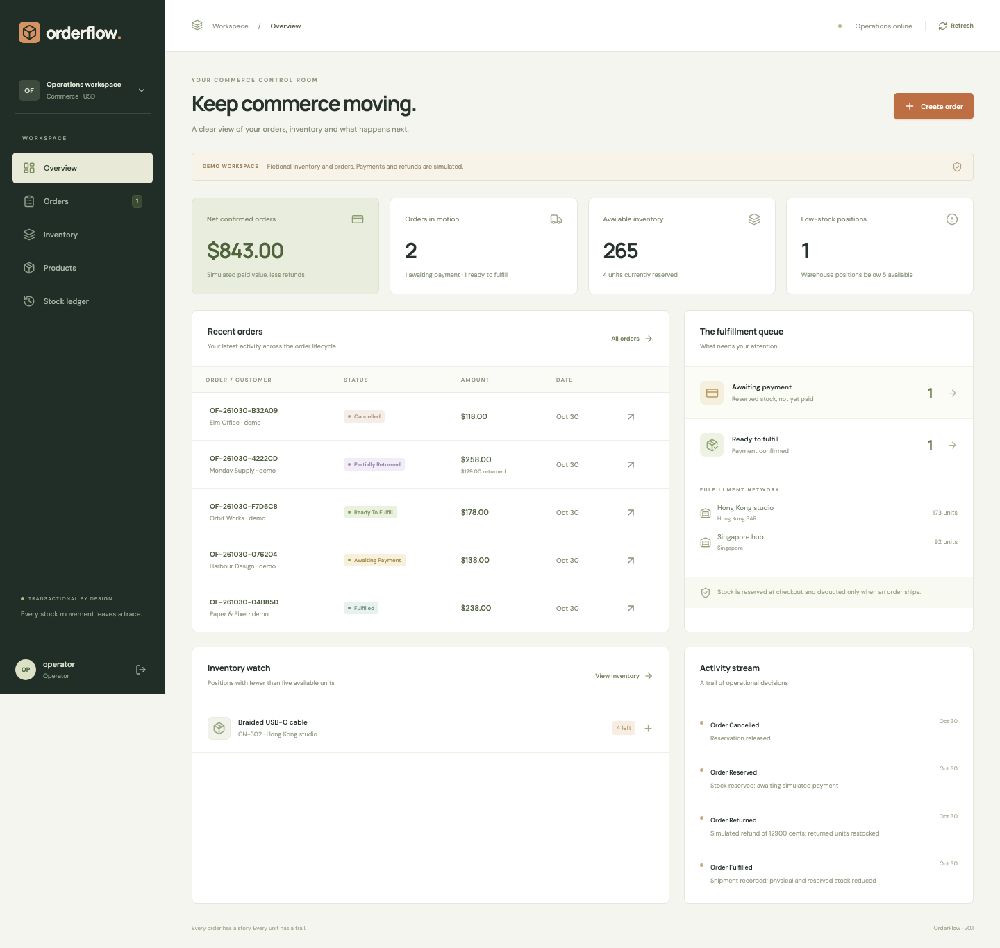
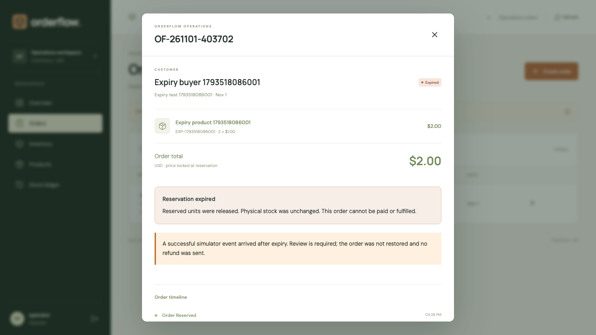
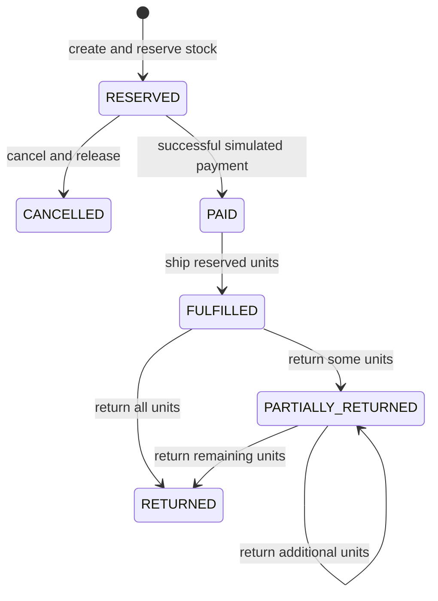

# OrderFlow

[](https://orderflow-demo-hsq1.onrender.com/)

**[Open the live demo](https://orderflow-demo-hsq1.onrender.com/)** · Select **Try the demo**; no account or password needed. The free server may take about a minute to wake. Visitors share synthetic data that resets on server restart. Payments are simulated.

**An order and inventory operations workspace built around transactional correctness.**

OrderFlow connects product catalog management, multi-warehouse inventory, order reservations, simulated payment events, fulfillment and partial returns. The backend is built with **Java 21, Spring Boot 4, Spring Security, JDBC and Flyway**; the operator interface uses **React and TypeScript**.

The application treats available inventory, historical order prices and retry-safe requests as explicit domain concerns. A request is successful only when its related stock changes, order transitions and audit records commit together.



## Implemented workflows

- Create products with unique SKUs, categories and integer-cent USD prices.
- Create warehouses and maintain a separate inventory position for each product/warehouse pair.
- Receive stock with a reason and retry-safe receipt identity.
- Reserve several products in one warehouse when creating an order.
- Snapshot product identifiers, names and prices into order lines.
- Inspect the order queue, amounts, states, event history and fulfillment location.
- Deliver simulated success/failure payment events, including repeated and late delivery.
- Fulfill paid orders, reducing both physical stock and active reservations.
- Cancel unpaid reservations without reducing physical stock.
- Expire unpaid reservations automatically from persisted deadlines, with restart recovery, transactional release and an explicit late-payment review queue.
- Record partial or complete returns, restore returned stock and calculate simulated refunds at original prices.
- Reconcile physical and reserved balances against an append-only application stock ledger.
- Sign in to the operator workspace using session authentication and CSRF-protected requests.

**Payments and refunds are simulations.** The application is not connected to a bank, payment processor or shipping carrier. Sample customers and opening inventory are fictional and labelled as demo data.

## Unpaid reservation expiry

Every new order stores an absolute UTC deadline. The normal default is **15 minutes**; the disposable public demo uses **60 seconds** so the complete scenario can be tried quickly. Set `RESERVATION_TTL_SECONDS` to 1–86400 seconds, or `0` for the mode default. Changing the setting affects new orders only; retrying the same creation key returns the original deadline and order.

A bounded worker scans up to 100 due orders every five seconds (`RESERVATION_POLL_MS`) and also runs once at application readiness. Each order is locked, rechecked and expired in its own transaction. Releasing all reserved lines, writing stock movements, changing the cancellation reason and appending the audit event either commit together or roll back together. Two workers cannot release the same reservation twice. A failed row is retried by later sweeps. This is database-backed deadline scanning, not a distributed queue or a guarantee of immediate processing during downtime/backlogs.

The payment simulator independently checks the deadline under the same order lock, even when the worker has not run. A success accepted before the deadline stays paid. At or after the deadline, the unpaid order is cancelled with `cancellation_reason=RESERVATION_EXPIRED`; a successful simulator event receives `LATE_SUCCESS_REVIEW` and cannot restore the order or consume stock. Failed late events receive `IGNORED_EXPIRED`. Event replay keeps the original outcome without duplicating stock changes. The acceptance instant is server time while holding the lock, not an unverified upstream event timestamp.

Order details show the deadline, approximate browser countdown and confirmed expiry; visible workspaces refresh every five seconds. **Orders → Late payment — review required** lists orders with retained late-success events. Review is informational in this release: no real charge/refund is sent and no external reconciliation or review-resolution action is implemented. Manual cancellations use `OPERATOR_CANCELLED` and retain their existing ignored-late-event policy.

Flyway V2 adds nullable deadline/reason/cancellation-time fields without changing the existing status vocabulary. Old unpaid V1 rows have no trustworthy deadline and migrate to deadline `0`, becoming immediately eligible for expiry. Paid/historical orders keep their existing state. Physical stock does not decrease when a reservation expires. Restart recovery requires persistent H2/PostgreSQL; the public in-memory demo is intentionally disposable.

Try the public demo: create an unpaid order, keep its details open and wait about a minute. Confirm **Expired**, inspect the timeline and check released inventory. For a fast isolated local browser verification, run `npm run test:expiry --prefix frontend` after building; it uses a ten-second lifetime on port 3203.



## Connected QA evidence

The real OrderFlow Chromium workflow can report to QualityHub with stable test identity, retries, screenshot/log/trace attachments and repository/commit/CI context. The CI integration exercises a clearly labelled injected order-API failure followed by normal recovery, checks every downloaded artifact hash, replays delivery and compares the runs. It uses a pinned, private temporary QualityHub instance with generated credentials; results are retained as Actions artifacts rather than depending on a sleeping public demo.

See [integration setup and evidence](docs/QUALITYHUB_INTEGRATION.md). No real payment provider or production outage is implied.

## Stack and responsibilities

| Layer | Technology | Purpose |
| --- | --- | --- |
| Backend | Java 21, Spring Boot 4.1.2 | Typed request contracts, application lifecycle and HTTP endpoints |
| Domain transactions | Spring transactions, JdbcTemplate | Explicit locking, atomic state changes and parameterized SQL |
| Security | Spring Security | Password hashing, operator session, session-fixation protection and CSRF checks |
| Database | PostgreSQL / H2 | Relational constraints and durable inventory/order records |
| Migrations | Flyway | Version-controlled database initialization |
| Frontend | React, TypeScript, Vite | Order operations, warehouse views and contextual detail dialogs |
| Testing | JUnit, Spring Boot Test, Playwright | Domain invariants, concurrent requests, HTTP security and complete browser workflow |
| Packaging | Executable Spring Boot JAR, multi-stage Docker build | Serve the interface and API from a single process |

JDBC was selected to keep lock acquisition and inventory updates visible in the domain code. H2 provides a self-contained local setup; PostgreSQL is supported through the JDBC driver and the same Flyway migration.

## Disposable public demo

Set `PUBLIC_DEMO=true` with an in-memory H2 URL, `SEED_DEMO=true`, secure cookies and explicit operator credentials. Visitors can enter using **Try the demo** without receiving the server credential. CSRF and session checks remain enabled. The public-demo endpoint is absent unless this mode is explicitly enabled, and startup rejects public demo mode with persistent storage.

All visitors share the same fictional workspace until the process stops. On restart, its in-memory records disappear and the initial sample dataset is recreated. This does not provide per-visitor isolation or durable storage. PostgreSQL remains available for a later persistent deployment.

## Start locally

Requirements: **Java 21**, **Node.js 24** and npm. A system Maven installation is unnecessary: `mvnw` downloads Apache Maven 3.9.16 into the ignored `.tools` directory and verifies the distribution's SHA-512 checksum.

From the repository root:

```sh
./scripts/build.sh
./scripts/start.sh
```

Open **http://127.0.0.1:3200**.

Local demonstration credentials:

```text
Username: operator
Password: local-demo-password
```

These are development defaults, not credentials for a hosted deployment. To use different credentials, export `OPERATOR_USERNAME` and `OPERATOR_PASSWORD` before starting the application. The default local database is stored under `data/` when using the start script.

The initial demo includes two warehouses, eight products and a set of fictional orders at different lifecycle stages. Set `SEED_DEMO=false` before the first startup for an empty workspace. Existing products prevent reseeding; restarting does not overwrite the database.

### Frontend development

Start the built backend on port 3200, then in another terminal:

```sh
cd frontend
npm ci
npm run dev
```

Open http://127.0.0.1:5174. Vite proxies `/api` to the Java service. Rebuild the packaged application to include interface changes in the JAR.

### PostgreSQL

For an existing PostgreSQL instance, export:

```sh
export JDBC_DATABASE_URL='jdbc:postgresql://127.0.0.1:5432/orderflow'
export DB_USER='orderflow'
export DB_PASSWORD='YOUR_DATABASE_PASSWORD'
./scripts/start.sh
```

The URL must be a JDBC URL, beginning with `jdbc:postgresql://`. Switching the database configuration does not migrate existing H2 records.

With Docker and Docker Compose installed, copy `.env.example` to `.env`, choose private database/operator passwords and run:

```sh
docker compose up --build
```

The application is bound to localhost port 3200. PostgreSQL stays on the Compose network and stores its data in a named volume. The local Compose configuration is not a complete public-hosting configuration.

## Inventory model

Each inventory position maintains:

```text
available = on_hand − reserved
0 ≤ reserved ≤ on_hand
```

| Operation | Physical stock | Reserved stock | Available stock |
| --- | --- | --- | --- |
| Receive 3 units | +3 | 0 | +3 |
| Reserve 2 units | 0 | +2 | −2 |
| Cancel that reservation | 0 | −2 | +2 |
| Ship the reserved 2 units | −2 | −2 | 0 |
| Return 1 shipped unit | +1 | 0 | +1 |

Inventory constraints exist in both the service logic and relational schema. Every successful stock-changing operation records its deltas in `stock_movements` within the same transaction.

## Order state machine



A failed payment event leaves an unexpired reservation open. A later successful event can confirm it only before its saved deadline. A successful event delivered after cancellation is recorded as ignored and cannot recreate a reservation or revive the order.

## Engineering challenges and solutions

### Contention for the last available item

A stock check performed outside a transaction allows two buyers to observe the same available unit. Order creation locks the selected inventory rows using `SELECT … FOR UPDATE`, validates all quantities and then creates the reservation within the same transaction. Products are locked in deterministic identifier order to reduce deadlock opportunities for multi-product requests.

**Verified behavior:** in the concurrent last-unit test, one request creates an order and the other receives a stock conflict. The final available quantity is zero and the reservation count is one.

### Duplicate delivery of requests

Order creation, stock receipts and returns accept an `Idempotency-Key`. The service stores a canonical request fingerprint and a reference to the resulting resource. Repeating identical input reuses the original operation; reusing the key with changed input returns HTTP 409.

A fixed set of 64 database lock buckets serializes competing requests for the same operation identity before the first idempotency record exists. This avoids relying on a process-local lock and supports database-coordinated execution. Unrelated keys can share a bucket, so this is a bounded correctness mechanism rather than a claim of maximum throughput.

Payment simulator events have their own externally supplied identity. An identical event is replay-safe, conflicting reuse is rejected and distinct late events cannot double-confirm an already paid order.

### Atomic multi-line reservations

A multi-product order must not reserve its first item and fail on its last. All selected inventory positions are checked under locks before reservation changes are written. The order, line snapshots, reservations, ledger entries, idempotency record and activity event share one transaction.

**Verified behavior:** a shortage in one line leaves all other stock reservations and order records unchanged.

### Monetary and historical consistency

Prices and totals use integer cents with checked arithmetic rather than floating-point accumulation. Order lines retain the unit price used at reservation. Partial-return refunds use those snapshots, so later catalog changes cannot alter an existing order's refund basis.

**Verified behavior:** a partial return restores only the specified units, calculates the original per-unit amount, survives duplicate delivery and rejects quantities above the unreturned shipment balance.

### Traceable stock balances

A current stock number is insufficient for diagnosis. Receipts, reservations, releases, shipments and returns append physical/reservation deltas to the stock ledger. The ledger is append-only through the exposed application API; it is not a cryptographically immutable or independently tamper-proof record.

**Verified behavior:** summed ledger deltas reconcile with the current inventory position after a shipment and partial return.

## Verification

```sh
./mvnw test
npm --prefix frontend run build
cd frontend
npx playwright install chromium
npm run test:e2e
cd ..
```

Build the JAR with frontend assets before running browser tests. Stop another application instance on port 3200 first. The browser suite starts an isolated in-memory database, signs in, creates a product/warehouse, receives stock, creates an order, simulates payment, ships it, records a partial return and checks the resulting stock after reloading.

The CI workflow additionally starts PostgreSQL and runs the domain tests with `TEST_DATABASE_URL`, `DB_USER` and `DB_PASSWORD`. H2 tests do not by themselves prove identical behavior on PostgreSQL. See [verification record](docs/VERIFICATION.md) for results actually observed.

## API

See [API contracts](docs/API.md) for request shapes, idempotency requirements, session handling and error semantics.

## Operational boundaries

- One configured operator account; no customer accounts, team invitations or tenant isolation.
- Operator details are configured through environment variables. Sessions are in memory and are invalidated by a process restart.
- No external payment integration, signed payment-provider webhooks, carrier booking or real refund execution.
- Reservation sweeps run only while the process is awake. Persistent databases recover overdue rows on startup; the disposable public demo loses its records on restart.
- Single USD currency; no tax, discounts, exchange rates or shipping-charge calculation.
- All returned units are restocked; damaged-stock quarantine is not implemented.
- Stock ledger and activity endpoints return bounded recent records; order/catalog lists are unpaginated.
- No public deployment or production load benchmark is claimed.

For a public deployment, set a private 16+ character `OPERATOR_PASSWORD`, `PRODUCTION=true` and `COOKIE_SECURE=true`, and serve the app through HTTPS with persistent PostgreSQL. Production startup rejects development credentials or insecure-cookie configuration. Never publish `.env`, the local database or session cookies.

## Repository structure

```text
backend/       Java application, Flyway migration and JUnit tests
frontend/      React interface and Playwright workflow
scripts/       Build and launch commands
.github/       CI verification with PostgreSQL
compose.yaml   Local application and database stack
Dockerfile     Frontend build, Java packaging and runtime image
```

[Architecture notes](docs/ARCHITECTURE.md) · [Development roadmap](docs/ROADMAP.md)
